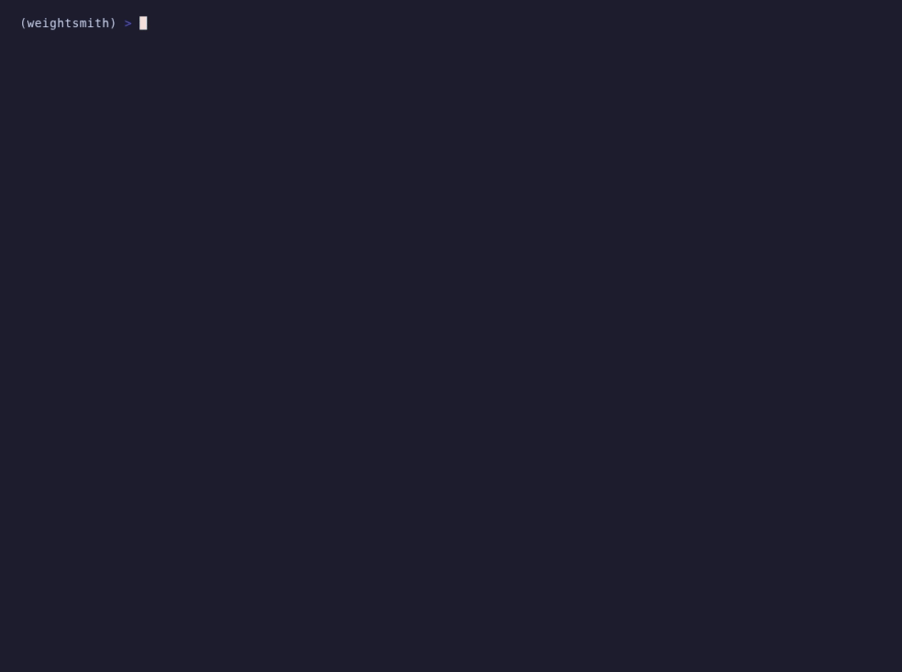

<h1 align="center">
  <br>
  Weightsmith
</h1>

<p align="center"><em>Don't retrain. Reforge.</em></p>

<p align="center">
  <a href="https://github.com/JGalego/weightsmith/actions/workflows/ci.yml"></a>
  <a href="https://www.python.org/downloads/"></a>
  <a href="https://github.com/JGalego/weightsmith/blob/main/LICENSE"></a>
  
  <a href="https://docs.astral.sh/uv/"></a>
  <a href="https://docs.astral.sh/ruff/"></a>
</p>

Weightsmith is a programming language for [weight-space programming](https://rikiyat.github.io/blog/weight-space-programming/). You load a network's parameters, inspect and edit them directly without gradient descent, and then verify the result against behaviours you declared up front.

The editing can be done by fixed strategies, by your own code, or by a language model working under a budget.

> [!NOTE]
> Weightsmith is pre-alpha, so the language and the Python API will change without notice.

## 🔨 Example

Claude gets a broken model, a budget and a contract in this program, and practises on one set of probes while Weightsmith judges the repair on another.

<a href="https://github.com/JGalego/weightsmith/blob/main/examples/repair_with_claude.wsm"></a>

Here is an abridged copy of Claude's report and the verdicts:

```
editor's account (a hypothesis): The broken task was count, and I've fixed it.
  The cause: two units in layer 0's feed-forward block, neurons 185 and 206, had weights
  about 10 times larger than any other neuron there.
  The fix: I zeroed both neurons completely, their input, gate and output weights.

improve  count_test     verified   improved by +0.1905, at least 0.1
preserve opposite_test  verified   changed by +0.0000; degradation within 0.07
preserve first_test     verified   changed by +0.0312; degradation within 0.02
require  finite         verified   no NaN or infinite parameters
Changed parameters: 384 of 131264 (0.2925%) in 3 tensor(s)
```

The original model is untouched, since the run writes an exact, reversible patch and a transcript of every exchange. The same repair with a scripted editor runs offline:



## 💡 Why a language

- Programs state intent (operations, behaviours, requirements) and leave execution to a backend, so the compiler can check them against tensor manifests without loading a tensor library.
- Every effect, from loading and probing to mutating, calling a language model and saving, must be allowed by a policy with budgets; the compiler rejects programs that overstep it, and the runtime stops before a budget runs out.
- Findings say how well supported they are (`observed`, `experimentally_supported`, ...), and verdicts are `verified`, `failed`, `inconclusive` or `skipped`.
- A run works on a copy of the model and emits a content-addressed patch that you can apply or revert.

## 📦 Installation

Weightsmith needs Python 3.12 or later and installs with [uv](https://docs.astral.sh/uv/):

```bash
git clone https://github.com/JGalego/weightsmith.git && cd weightsmith
uv sync                      # installs CPU-only PyTorch from the PyTorch index
uv run weightsmith --version
```

Extras: `hf` runs Hugging Face models, `anthropic` and `openai` enable language-model editors, `lsp` adds the language server. `uv sync` installs them all; checking programs needs none of them.

## 🚀 Quick start

```bash
uv run weightsmith fixtures                         # build the synthetic models (under a minute, CPU)
uv run weightsmith check examples/repair_mlp.wsm    # static checks only, no tensors loaded
uv run weightsmith run   examples/repair_mlp.wsm --out out/repair
uv run weightsmith diff  examples/fixtures/tiny_mlp_defective out/repair/model
uv run weightsmith apply examples/fixtures/tiny_mlp_defective out/repair/patch --out out/applied
```

## 🧪 Examples

These run on synthetic models with planted defects, built by `weightsmith fixtures`.

**Find and repair**

- [inspect_transformer.wsm](https://github.com/JGalego/weightsmith/blob/main/examples/inspect_transformer.wsm): structural finders on raw Transformer weights catch a NaN, a duplicate tensor and a dead row.
- [repair_mlp.wsm](https://github.com/JGalego/weightsmith/blob/main/examples/repair_mlp.wsm): finds the outlying rows and repairs them, then backs each finding with intervention evidence before verifying the result.
- [repair_tiny_llama.wsm](https://github.com/JGalego/weightsmith/blob/main/examples/repair_tiny_llama.wsm): finds amplified MLP neurons in a Llama-style model by role; `count` goes from 0.70 to 1.00.
- [prune_mlp.wsm](https://github.com/JGalego/weightsmith/blob/main/examples/prune_mlp.wsm): prunes by magnitude and zeroes a slice while preserving both behaviours.

**Merge and transplant**

- [merge_mlps.wsm](https://github.com/JGalego/weightsmith/blob/main/examples/merge_mlps.wsm): interpolates with a fine-tuned variant and transplants a layer.
- [merge_unrelated.wsm](https://github.com/JGalego/weightsmith/blob/main/examples/merge_unrelated.wsm): runs the same merge with an unrelated model, and verification fails as it should.
- [head_surgery.wsm](https://github.com/JGalego/weightsmith/blob/main/examples/head_surgery.wsm): zeroes an attention head and transplants a key/value head from a donor.

**Language models as editors**

- [repair_with_editor.wsm](https://github.com/JGalego/weightsmith/blob/main/examples/repair_with_editor.wsm): a scripted editor that runs offline and replays exactly with `--replay`.
- [repair_with_claude.wsm](https://github.com/JGalego/weightsmith/blob/main/examples/repair_with_claude.wsm): gives the same task to Claude, with only "one task is broken" as a hint, through the Anthropic API.

## ✨ Replicating *Sparks of weight-space programming*

[examples/wsp/](https://github.com/JGalego/weightsmith/tree/main/examples/wsp) reruns the experiments from [the article](https://rikiyat.github.io/blog/weight-space-programming/) with its own networks and prompts and with GPT-6 Astra as the editor. `uv run python examples/wsp/fetch.py` downloads them from the [published logs](https://github.com/RikiyaT/lm_understand-logs) (CC BY 4.0) and checks that every prompt rebuilds byte for byte.

| Experiment | Article | Weightsmith[^cost] |
|---|---|---|
| [which_game.wsm](https://github.com/JGalego/weightsmith/blob/main/examples/wsp/which_game.wsm): name the game a PPO policy plays from its weights alone | Right for every network | Right for every network with similar confidence |
| [fix_car.wsm](https://github.com/JGalego/weightsmith/blob/main/examples/wsp/fix_car.wsm): fix a Kinetix car policy in one reply without tools | 0% → 100% success | The article's edit replays to 100%; our own live run stayed at 0% |
| [math_eval.wsm](https://github.com/JGalego/weightsmith/blob/main/examples/wsp/math_eval.wsm): MATH-500 before and after the article's edit to Qwen3.5-0.8B | 7.9% → 48.1% | 6.0% → 52.0% on the first of ten shards, where the article got 7.0% → 37.0%[^grader] |

[^cost]: The live runs cost about \$10 in OpenAI calls and \$2 of GPU time on Hugging Face Jobs.
[^grader]: The grader is the article's, so the gap lies in generation.

## 👀 Language at a glance

| Construct | Example |
|---|---|
| Load weights only | `weights W = load("model.safetensors")` |
| Load a runnable model | `model M = load("dir")` (weights plus `arch.json`, or a Hugging Face `config.json`) |
| Declare a behaviour | `behavior b = probes("suite.json", metric = accuracy)` |
| Select parameters | `M.params["layers.*.weight"]`, then slice: `s[0..4, :]` |
| Select by role | `M.embed`, `M.layers[0..4].mlp`, `M.layers[1].attn.heads[2]`, `M.layers[0].mlp.neurons[17]` |
| Inspect | `inspect`, `inspect M.params["head.*"]` |
| Search | `find outlier_rows (threshold = 8.0)`, `find anomalies (kinds = [...])` |
| Edit | `edit { prune_magnitude s (fraction = 20%)  zero s[3, :] }` |
| Compose | `compose { interpolate Donor (alpha = 0.5)  transplant Donor.params["layers.1.*"] }` |
| Repair | `repair (strategies = [rescale_outlier_rows])` |
| Declare an editor | `editor Claude = provider("anthropic", model = "claude-opus-5-5")` |
| Delegate to it | `delegate Claude (task = "...", tools = [describe, run_probes, edit, python], practice = [b_train])` |
| Ask it a question | `delegate E (message_file = "prompt.txt", tools = [], protocol = "blocks")` then `require answer (editor = E, field = "Game", matches = "(?i)breakout")` |
| Contract and verify | `contract { improve b (min_delta = 0.1)  preserve c (tolerance = 0.02) }` then `verify` |
| Policy | `policy { allow probe(max_forward_passes = 500)  allow mutate(max_changed_params = 5%)  allow reason(max_calls = 20) }` |
| Output | `output { model, patch, findings, evidence, evaluation, summary }` |

The full definition is in [docs/semantics.md](https://github.com/JGalego/weightsmith/blob/main/docs/semantics.md).

## 💻 Command line

| Command | Does |
|---|---|
| `weightsmith check FILE` | Syntax, names, types and effects; never imports PyTorch |
| `weightsmith compile FILE [-o out.json] [--text]` | Emit IR as JSON or readable text |
| `weightsmith run FILE [--out DIR] [--dry-run] [--replay DIR] [--env-file F] [--json]` | Run a program; `--replay` answers editors from recorded transcripts |
| `weightsmith inspect PATH` | Statistics, architecture profile and structural findings for a weight file or model directory |
| `weightsmith diff A B [--out DIR]` | Compare two weight sets; optionally save a patch |
| `weightsmith apply BASE PATCH --out DIR [--reverse]` | Apply or revert a patch, checking hashes |
| `weightsmith fixtures [DIR]` | Build the synthetic fixtures |
| `weightsmith lsp` | Language server on stdio, with hover documentation |

`run` exits with 0 when everything is verified, 1 for an invalid program, 2 for a runtime error or budget stop, 3 when a contract item failed and 4 when one was inconclusive.

## ⚖️ How it compares

- **Fine-tuning and LoRA** change weights by gradient descent on data. Weightsmith changes them directly and checks the result against a contract.
- **[mergekit](https://github.com/arcee-ai/mergekit)** merges checkpoints with methods such as SLERP and TIES. Weightsmith's `compose` also merges, but it does so under a policy and fails verification when a merge breaks a declared behaviour.
- **[TransformerLens](https://github.com/TransformerLensOrg/TransformerLens)** and similar libraries study activations and circuits. Weightsmith's finders are cruder weight statistics, but its edits are verified and shipped as patches.
- **[weightspace](https://github.com/leofmarciano/weightspace)** explores language-model-driven weight editing in Python. Weightsmith doesn't depend on it.

## ⚠️ Known limitations

- Runnable models are sequential `arch.json` networks or Hugging Face causal language models. Roles exist for the GPT-2 and Llama families; other models are addressed by parameter name.
- Finders locate statistical anomalies in weights, not capabilities, circuits or features. Asking for "the reasoning circuit" is a compile error.
- Behaviours are probe suites, Kinetix rollouts, or MATH-500 and GSM8K on Hugging Face Jobs.
- The `python` tool is not a security sandbox, because editor code runs as you, though without credentials and within a time limit.
- Verdicts hold only for the declared probes and come without confidence intervals.
- Patches store replacement values, so a dense patch is about twice the size of the tensors it changes.
- Merging unrelated networks fails without permutation alignment, which Weightsmith doesn't do.

See [docs/vision.md](https://github.com/JGalego/weightsmith/blob/main/docs/vision.md) for where the language is headed and [CONTRIBUTING.md](https://github.com/JGalego/weightsmith/blob/main/CONTRIBUTING.md) to work on it.

## 📜 Licence

Apache-2.0. See [LICENSE](https://github.com/JGalego/weightsmith/blob/main/LICENSE).
