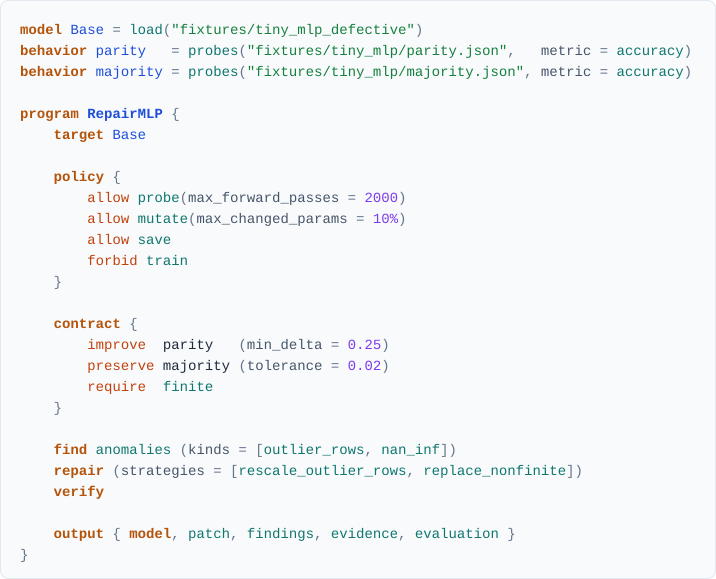

<h1 align="center">
  <br>
  Weightsmith
</h1>

<p align="center"><em>Don't retrain. Reforge.</em></p>

<p align="center">
  <a href="https://www.python.org/downloads/"></a>
  <a href="LICENSE"></a>
  
  <a href="https://docs.astral.sh/uv/"></a>
  <a href="https://docs.astral.sh/ruff/"></a>
</p>

Weightsmith is a programming language for [weight-space programming](https://rikiyat.github.io/blog/weight-space-programming/). It treats neural networks as programmable objects. A Weightsmith program loads a network's parameters, inspects and searches them, edits and composes them, and then *verifies* the result against declared behaviours, under an explicit policy of what it is allowed to do.

<a href="examples/repair_mlp.wsm"></a>

Running it on a small network with a planted defect gives this result (abridged):

```
outlier_rows [experimentally_supported] 2 row(s) of layers.1.weight have outlying norms (up to 57.1x the median)
  evidence (observed, row_norm_robust_z): rows=[9, 12], z_scores=[230.16, 266.22], median_norm=3.264
  evidence (experimentally_supported, intervention:rescale_outlier_rows): ... verified improvement of
    'parity' from 0.6914 to 1.0000.
  limitation: This is a statistical observation about the weights. It does not establish that the
    location causes any behaviour.

improve parity          verified   improved by +0.3086, at least 0.25
preserve majority       verified   changed by +0.0195; degradation within 0.02
require finite          verified   no NaN or infinite parameters
Changed parameters: 130 of 4996 (2.6021%) in 2 tensor(s)
Forward passes: 1024 of 2000 allowed
```

No gradient descent was used. The original model file is untouched. The patch is exact and reversible, and every claim is labelled with how strongly it is supported.

> [!WARNING]
> Weightsmith is pre-alpha. The language, its standard strategies and the Python API will change without notice.
>
> **Status: unreleased.** The language core, compiler, effect system, PyTorch backend, patches and verification work end to end on small CPU models, including Hugging Face language models addressed by role (`M.layers[1].attn.heads[2]`). A language model such as Claude can act as the editor through `delegate`, under the same budgets and verification, with every exchange recorded and replayable. Semantic operations such as "find the reasoning circuit" do not exist yet, and the compiler says so rather than pretending. See [docs/vision.md](docs/vision.md).

## Why a language

- **Intent separated from execution.** Programs name operations, behaviours and requirements. The compiler checks them against tensor manifests without loading a tensor library. A backend executes them.
- **Effects are explicit.** Loading, inspecting, probing, mutating, training, calling a reasoning provider and saving are effects. A policy allows them with budgets. The compiler rejects programs that overstep the policy, and the runtime stops before exceeding a budget.
- **Evidence is typed.** Findings carry evidence levels with operational definitions (`observed`, `experimentally_supported`, ...). Verdicts are `verified`, `failed`, `inconclusive` or `skipped`, never a reassuring message.
- **Modifications are artifacts.** Every run works on a copy-on-write working copy and can emit an exact, content-addressed patch that can be applied or reverted.

## Installation

Weightsmith needs Python 3.12 or later. With [uv](https://docs.astral.sh/uv/):

```bash
git clone https://github.com/JGalego/weightsmith.git && cd weightsmith
uv sync                      # installs CPU-only PyTorch from the PyTorch index
uv run weightsmith --version
```

Running Hugging Face models needs the `hf` extra (`pip install 'weightsmith[hf]'`, which adds `transformers`). Language-model editors need the `anthropic` or `openai` extra. The development environment that `uv sync` creates includes all three. Checking programs never needs them.

## Quick start

```bash
uv run weightsmith fixtures                         # build the synthetic models (under a minute, CPU)
uv run weightsmith check examples/repair_mlp.wsm    # static checks only, no tensors loaded
uv run weightsmith run   examples/repair_mlp.wsm --out out/repair
uv run weightsmith diff  examples/fixtures/tiny_mlp_defective out/repair/model
uv run weightsmith apply examples/fixtures/tiny_mlp_defective out/repair/patch --out out/applied
```

## Examples

All examples run on synthetic fixtures with known ground truth (`weightsmith fixtures`).

| Example | Shows | Expected outcome |
|---|---|---|
| [inspect_transformer.wsm](examples/inspect_transformer.wsm) | Raw `weights` with no architecture; structural finders on Transformer-shaped tensors | Finds exactly the three planted defects: a NaN, a duplicate tensor, a dead row |
| [repair_mlp.wsm](examples/repair_mlp.wsm) | `find` then `repair` then `verify`, with intervention evidence | All contract items verified; 2.6% of parameters changed |
| [merge_mlps.wsm](examples/merge_mlps.wsm) | `compose`: interpolate with a fine-tuned variant, transplant a layer | Both behaviours preserved |
| [merge_unrelated.wsm](examples/merge_unrelated.wsm) | The same merge with an independently trained model | Verification **fails** (exit code 3), as it should |
| [prune_mlp.wsm](examples/prune_mlp.wsm) | Imperative `edit`: magnitude pruning and zeroing a slice | Behaviours preserved; 17% of parameters changed |
| [repair_tiny_llama.wsm](examples/repair_tiny_llama.wsm) | A Hugging Face Llama-style model with two amplified MLP neurons; `find outlier_neurons`, `repair`, next-token probes | Finds exactly the planted neurons; `count` rises from 0.70 to 1.00, the other tasks are preserved; 0.2% of parameters changed |
| [repair_with_editor.wsm](examples/repair_with_editor.wsm) | `delegate`: an editor repairs the model through tools (here a deterministic script that writes Python), practising on `*_train` probes; the contract verifies on disjoint `*_test` probes | All contract items verified; replays exactly with `--replay` |
| [repair_with_claude.wsm](examples/repair_with_claude.wsm) | The same task given to Claude, with only "one task is broken" as a hint. Calls the Anthropic API and costs money | Whatever Claude achieves, verified the same way |
| [head_surgery.wsm](examples/head_surgery.wsm) | Editing by role: zero one attention head, transplant a key/value head from a fine-tuned donor | All three behaviours preserved; 3.1% of parameters changed |

## Language at a glance

| Construct | Example |
|---|---|
| Load weights only | `weights W = load("model.safetensors")` |
| Load a runnable model | `model M = load("dir")` (weights plus `arch.json`, or a Hugging Face `config.json`) |
| Declare a behaviour | `behavior b = probes("suite.json", metric = accuracy)`, with input vectors or next-token prompts |
| Select parameters | `M.params["layers.*.weight"]`, then slice: `s[0..4, :]` |
| Select by role | `M.embed`, `M.layers[0..4].mlp`, `M.layers[1].attn.heads[2]`, `M.layers[0].mlp.neurons[17]` |
| Inspect | `inspect`, `inspect M.params["head.*"]` |
| Search | `find outlier_rows (threshold = 8.0)`, `find anomalies (kinds = [...])` |
| Edit | `edit { prune_magnitude s (fraction = 20%)  zero s[3, :] }` |
| Compose | `compose { interpolate Donor (alpha = 0.5)  transplant Donor.params["layers.1.*"] }` |
| Repair | `repair (strategies = [rescale_outlier_rows])` |
| Declare an editor | `editor Claude = provider("anthropic", model = "claude-opus-5-5")` |
| Delegate to it | `delegate Claude (task = "...", tools = [describe, run_probes, edit, python], practice = [b_train])` |
| Contract and verify | `contract { improve b (min_delta = 0.1)  preserve c (tolerance = 0.02) }` then `verify` |
| Policy | `policy { allow probe(max_forward_passes = 500)  allow mutate(max_changed_params = 5%)  allow reason(max_calls = 20) }` |
| Output | `output { model, patch, findings, evidence, evaluation, summary }` |

The full definition is in [docs/semantics.md](docs/semantics.md).

## Architecture

```
source (.wsm)
  -> parser (Lark, LALR)            language/grammar.lark, parser.py, nodes.py
  -> name resolution + type check   compiler/typecheck.py   (reads safetensors headers, no torch)
  -> lowering to IR                 compiler/lower.py, ir.py  (JSON-serialisable)
  -> effect check against policy    compiler/effects.py
  -> planner                        runtime/planner.py    (backend capabilities, repair planning)
  -> executor                       runtime/executor.py   (working copy, budgets, verification)
  -> backend                        backends/base.py (protocol), backends/pytorch/
  -> artifacts + report             model/, patch/, report.json
```

| Package | Responsibility |
|---|---|
| `language` | Grammar, parser, AST nodes with source spans |
| `compiler` | Types, name resolution and checking, effects and policies, IR, lowering |
| `registry` | Names and parameter schemas of finders, operations, strategies and metrics; torch-free |
| `models` | Tensor manifests from safetensors headers; architecture specs; Hugging Face configs and architecture profiles (roles to tensor regions) |
| `runtime` | Planner, executor, working copy, budgets |
| `backends` | Backend protocol with capability declaration; the PyTorch backend |
| `evaluation` | Probe suites, verdict semantics, run reports |
| `artifacts` | Patch manifest schema, provenance |
| `evidence` | Findings, evidence levels |
| `reasoning` | Editors: Anthropic, OpenAI-compatible and scripted providers; recording and exact replay |
| `synthetic`, `synthetic_lm` | Fixture models with planted defects and known ground truth, including a tiny Llama-style language model |

## Command line

| Command | Does |
|---|---|
| `weightsmith check FILE` | Syntax, names, types and effects; never imports PyTorch |
| `weightsmith compile FILE [-o out.json] [--text]` | Emit IR as JSON or readable text |
| `weightsmith run FILE [--out DIR] [--dry-run] [--replay DIR] [--json]` | Run a `.wsm` program or compiled IR; `--replay` answers editors from recorded transcripts |
| `weightsmith inspect PATH` | Statistics, architecture profile and structural findings for a weight file or model directory |
| `weightsmith diff A B [--out DIR]` | Compare two weight sets; optionally save a patch |
| `weightsmith apply BASE PATCH --out DIR [--reverse]` | Apply or revert a patch, checking hashes |
| `weightsmith fixtures [DIR]` | Build the synthetic fixtures |

`run` exit codes: 0 verified, 1 invalid program, 2 runtime error or budget stop, 3 a contract item failed, 4 a contract item was inconclusive.

## Development

```bash
uv sync
uv run pytest           # unit and end-to-end tests; builds fixtures once into .pytest_cache
uv run ruff check . && uv run ruff format --check .
uv run pyright
```

## Known limitations

- Runnable models are sequential `arch.json` networks or Hugging Face causal language models. Roles exist for the GPT-2 and Llama families only; other models are addressed by parameter name.
- Finders are structural statistics. They locate anomalies in weights, not capabilities, circuits or features.
- Behaviours are classification or next-token probe suites with an accuracy metric. There is no generation, sampling or benchmark harness yet.
- Editors are measured only by probe suites: there are no game rollouts or sampled benchmarks such as MATH-500 yet, which several published weight-space programming experiments need.
- The `python` tool is not a sandbox in the security sense: editor code runs as you, without credentials and with a time limit.
- Verdicts hold for the declared probe suite only. No confidence intervals are computed.
- Patches store replacement values, so a dense patch is about twice the size of the tensors it changes.
- Interpolating unrelated networks fails without permutation alignment, and Weightsmith does not align them.

## Relationship to other projects

[`weightspace`](https://github.com/leofmarciano/weightspace) explores LLM-driven weight editing in Python. Weightsmith neither depends on it nor builds on its concepts. An adapter could become an optional backend behind `backends/base.py`.

## Licence

Apache-2.0. See [LICENSE](LICENSE).
